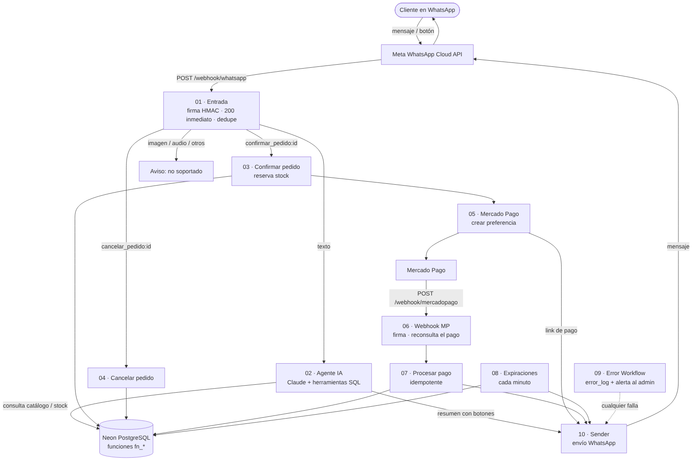
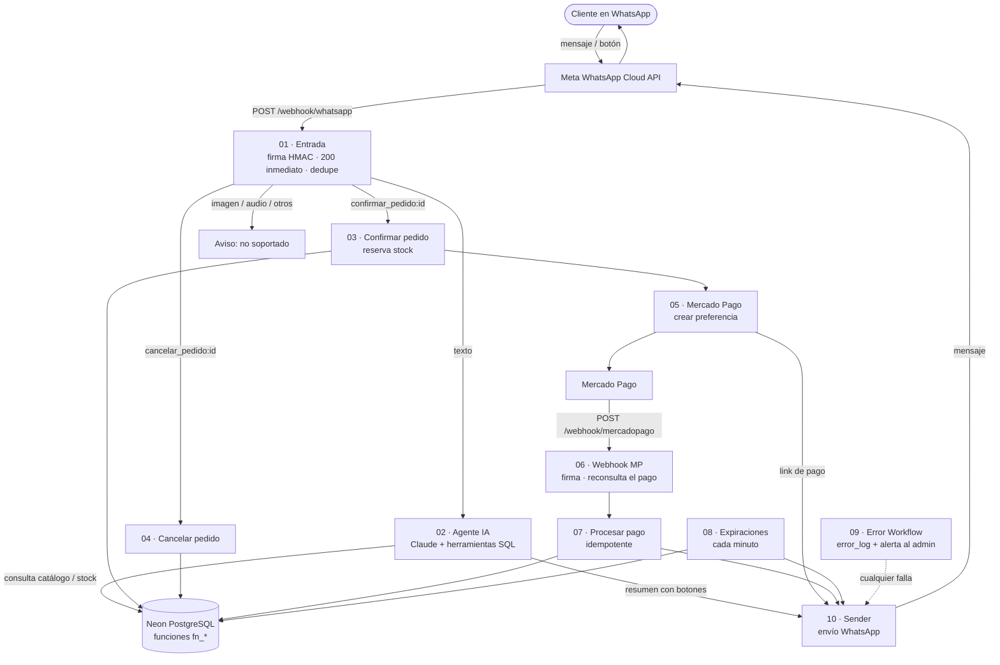

# WhatsApp con IA: ventas y pagos automatizados (n8n)

Asistente de ventas por WhatsApp construido en **n8n**. El cliente conversa con una IA (Claude) que le muestra el catálogo y el stock reales, arma el pedido, le pide confirmación con botones y le envía un link de pago de **Mercado Pago**. Cuando el pago se aprueba, el sistema lo registra y avisa al cliente.

La IA **solo consulta y propone**: nunca confirma pedidos, reserva stock ni da por pagado nada. Todo eso lo hace el sistema con funciones SQL en PostgreSQL.

## Cómo funciona

Versión interactiva del diagrama (Mermaid)

### Flujo de una compra
1. El cliente escribe; Meta envía el mensaje al webhook (**01**), que valida la firma, responde 200 al instante y evita procesar eventos duplicados.
2. Los textos van al **agente IA (02)**, que consulta productos, variantes y stock con herramientas SQL acotadas (sin SQL libre) y, cuando el cliente quiere comprar, prepara un borrador de pedido.
3. n8n envía un resumen con botones **Confirmar / Cancelar**.
4. **Confirmar (03)** reserva el stock en la base de datos y llama a **05**, que crea la preferencia en Mercado Pago y envía el link de pago. **Cancelar (04)** libera el pedido.
5. Mercado Pago avisa al **webhook (06)**, que valida la firma y vuelve a consultar el pago a la API de MP (no confía en el cuerpo recibido). Luego **07** marca el pedido como pagado de forma idempotente y notifica al cliente.
6. **08** corre cada minuto: expira reservas vencidas y libera el stock. Una limpieza diaria borra eventos antiguos.
7. **09** captura errores de cualquier workflow, los guarda en `error_log` y avisa al administrador por WhatsApp.

## Workflows

| # | Archivo | Qué hace |
|---|---------|----------|
| 01 | `01 - WhatsApp_ Entrada (webhook)` | Recibe y verifica webhooks de Meta, deduplica y enruta |
| 02 | `02 - WhatsApp_ Agente IA` | Agente Claude con memoria por teléfono y 7 herramientas SQL |
| 03 | `03 - Pedido_ Confirmar` | Confirma el pedido y reserva stock |
| 04 | `04 - Pedido_ Cancelar` | Cancela el pedido |
| 05 | `05 - Mercado Pago_ Crear pago` | Crea la preferencia de pago y envía el link |
| 06 | `06 - Mercado Pago_ Webhook` | Recibe notificaciones de pago y las verifica |
| 07 | `07 - Pedido_ Procesar pago` | Registra el pago y notifica |
| 08 | `08 - Stock_ Expiraciones` | Expira reservas y limpia eventos |
| 09 | `09 - Error Workflow` | Registro de errores y alertas al admin |
| 10 | `10 - WhatsApp_ Sender` | Sub-workflow reutilizable para enviar mensajes |

## Requisitos
- n8n con acceso público por HTTPS (por ejemplo en Railway).
- Base de datos PostgreSQL (se usó [Neon](https://neon.tech)).
- Cuenta de Meta for Developers con la **WhatsApp Cloud API** y un número configurado.
- Cuenta de **Mercado Pago** con una aplicación (credenciales de prueba para empezar).
- API key de **Anthropic** (modelo `claude-haiku-4-5`).

## Puesta en marcha (paso a paso)

### 1. Base de datos
Crea un proyecto en [Neon](https://neon.tech) y ejecuta en el SQL Editor, en este orden:
1. [`database/schema.sql`](database/schema.sql): tablas, índices, triggers, la vista de control de stock y las 21 funciones SQL (`fn_*`) que usan los workflows. Incluye la máquina de estados de los pedidos.
2. [`database/seed_ejemplo.sql`](database/seed_ejemplo.sql) *(opcional)*: una tienda con 2 productos y 5 variantes de ejemplo. Reemplázalo por tu catálogo real.

La tabla `n8n_chat_histories` (memoria del agente) también viene en el esquema, aunque n8n la crearía sola.

El esquema se probó cargándolo en una base vacía y recorriendo un flujo completo (preparar, confirmar, pagar, pago repetido, pago con monto incorrecto, expirar, cancelar y deduplicar webhooks).

### 2. Variables de entorno
Copia `.env.example`, complétalo y cárgalo en las variables de tu n8n. Son obligatorias `NODE_FUNCTION_ALLOW_BUILTIN=crypto` y `N8N_BLOCK_ENV_ACCESS_IN_NODE=false`.

### 3. Credenciales en n8n
| Nombre | Tipo | Contenido |
|--------|------|-----------|
| `Neon PostgreSQL` | Postgres | Datos de conexión de Neon (SSL activado). Cópialos desde el botón *Connect* del proyecto |
| `Meta WhatsApp Access Token` | Header Auth | `Authorization` = `Bearer <token de Meta>` |
| `Mercado Pago Access Token` | Header Auth | `Authorization` = `Bearer <access token de MP>` |
| `Claude` | Anthropic | Tu API key de Anthropic |

### 4. Importar los workflows
Importa los 10 archivos de `workflows/` en n8n (Workflows → Import from file). Ya traen las referencias entre sí y el Error Workflow configurados con los IDs de la instancia original; si tu n8n asigna IDs distintos, vuelve a seleccionar los sub-workflows en los nodos *Execute Workflow* y el Error Workflow en Settings. Luego asigna las credenciales del paso 3 a los nodos que lo pidan, en especial **Crear Preferencia MP** (workflow 05).

### 5. Configurar el webhook de Meta
En Meta for Developers → WhatsApp → Configuration:
- URL de callback: `https://TU-N8N/webhook/whatsapp`
- Token de verificación: el valor de `WHATSAPP_VERIFY_TOKEN`
- Suscríbete al campo `messages`.

### 6. Configurar el webhook de Mercado Pago
En el panel de tu aplicación → Webhooks, usa `https://TU-N8N/webhook/mercadopago`, selecciona el evento **Pagos**, y copia la clave secreta en `MP_WEBHOOK_SECRET`.

### 7. Activar y probar
1. Activa los workflows **09**, **10**, **07**, **05**, **04**, **03**, **02**, **06**, **08** y por último el **01**.
2. Con `MP_USE_SANDBOX=true`, escribe al número de WhatsApp: pide ver productos, elige uno, confirma con el botón y paga con una tarjeta de prueba de Mercado Pago.
3. Revisa que el pedido pase a PAGADO y que llegue el aviso. Los errores quedan en la tabla `error_log`.
4. Para pasar a producción: `MP_USE_SANDBOX=false` y credenciales productivas.

## Seguridad
- Firma HMAC (`x-hub-signature-256`) verificada en el webhook de Meta; firma `x-signature` obligatoria en el de Mercado Pago.
- Los pagos se verifican consultando la API de Mercado Pago, no con los datos del webhook.
- El agente no ejecuta SQL libre: cada herramienta llama a una función con parámetros, y el teléfono del cliente lo fija n8n, no el modelo.
- Procesamiento idempotente: webhooks duplicados no repiten acciones ni mensajes.
- No subas tokens ni claves al repositorio; usan credenciales y variables de entorno de n8n.
